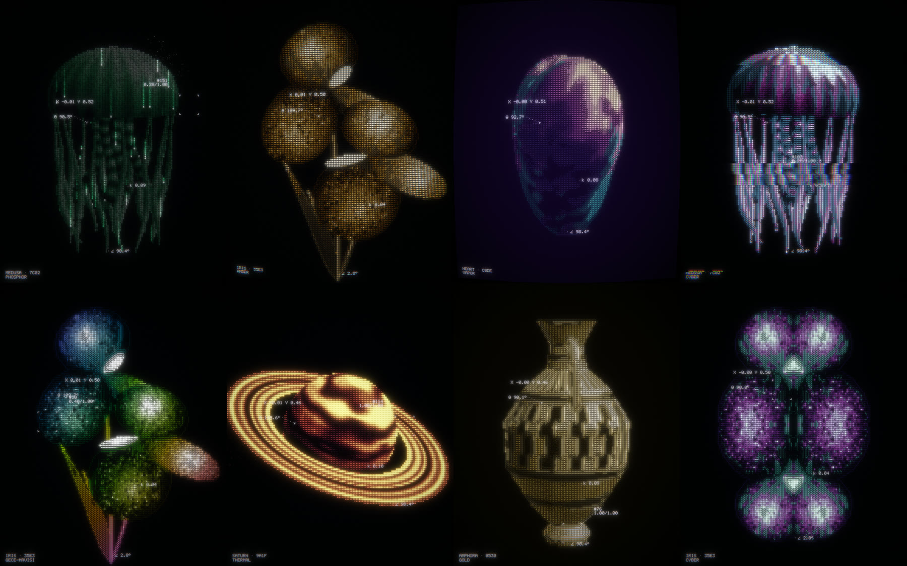

<h1 align="center"></h1>

<p align="center">
  Turn any image, GIF or short video into glowing glyph art, then spin it as a 3D object.<br>
  One HTML file. No install, no upload, no server.
</p>

<p align="center">
  <a href="https://winchxyz.github.io/afterglyph/"><b>Open the live app →</b></a>
</p>

<p align="center">
  <a href="https://winchxyz.github.io/afterglyph/"></a>
</p>

## What it does

Every frame is rebuilt on a fixed 7×9 pixel character grid. Each cell picks its own glyph from what the picture is doing at that spot:

| In the picture | On the grid |
| --- | --- |
| A strong edge | Bold strokes that follow it: `/` `\` `‖` `=` |
| Fine texture with a direction | Thin hatching along that direction |
| Flat areas | A brightness ramp: `.` `-` `=` `√` `π` `0` `◎` `●` `■` |
| The outline of the subject | A thin contour one cell outside it |
| Parts that are still appearing | Flickering digits |

On top of the grid: bloom, a slight colour fringe, film grain, and live readouts (a tracker box, centroid X/Y, the subject's main axis θ, the turn angle ∠).

<p align="center">
  
</p>

## Features




- **Your own files.** Drop, paste or open a PNG, JPG, WebP, GIF or a short MP4/WebM. GIFs and videos stay animated.
- **Type a word.** Any text becomes a glowing object that grows in, and it works in 3D too. Use `|` for a line break.
- **Live camera.** Your webcam as live glyph art. With the soundtrack on, movement plays notes.
- **3D object.** Tick *3D object* and the picture becomes a rounded relief with a front and a back. Drag to turn it, scroll to zoom, or let it turn by itself.
- **Subject lift.** On a picture with a real background, 3D finds the subject by itself, turns only the subject and keeps the background flat and still behind it. The area under the subject is painted in, so no double shows when it turns.
- **AI depth.** One button runs a small Depth Anything V2 model in the browser (27 MB, downloaded once) and gives the 3D object real depth. The picture never leaves the device.
- **Depth map.** Add a grey depth picture (white is near) and the 3D object gets real depth instead of a rounded guess.
- **Nine templates.** Iris, Planet, Jellyfish, Helix, Knot, Heart, Crystal, Amphora and Mushroom. All are generated in code, so there are no asset files.
- **Grow-in intro.** The subject grows from its lowest point upward, with a ruler counting 0.05 to 0.96 beside the tip.
- **Background tools.** Auto removes a plain background by colour and finds the subject by itself on a busy picture. Or pick the mode: find the subject, remove dark, remove light, remove a colour picked from the picture, keep everything. Cut strength, edge softness, grow or shrink, speck cleanup, cut only from the outside, and a preview of what is kept.
- **Editor.** Paint over what must stay or go, on top of any cut, with undo. The same editor sets a focus point and places your own marks.
- **Focus point.** Click the spot that matters: the close-up, the tracker, the pulse and a spotlight aim at it.
- **Light and dark.** Dark drawings on light paper are noticed and swapped automatically, colours kept; or force it either way.
- **Fifteen looks.** Signal, Terminal, Matrix, Amber CRT, Blueprint, Halftone, Blocks, Vapor, Glitch, Prism, Thermal, Gold, Kaleido, Newsprint and Typewriter. One click sets characters, colour and screen effects. *Surprise me* (or the R key) rolls a random one, and you can save your own.
- **Character sets.** Mixed symbols, classic ASCII, the full 70-character ramp, halftone dots, shade blocks, lines only, digits, binary, or your own characters (sorted from light to heavy automatically).
- **Colour.** From the file, thirteen palettes or your own three colours, plus a backdrop colour, hue shift, rainbow spread and colour drift over time.
- **Effects.** Glow, scanlines, grain, lens fringe, screen curve, digit rain, mirror and kaleidoscope, ink on paper. Five intro styles and a speed control.
- **Glitch controls.** Amount, row shift, row height, speed, colour split, jumping blocks, static, picture roll and character scramble.
- **Every overlay is editable.** Tracker, readouts, ruler, caption, sparks, pulse, rain and your own marks each have a switch, a shape, a colour and speed and size sliders. Place marks by hand with your own labels when the automatic ones land in the wrong spot.
- **Tabbed panel.** Source, Look, Colour, Motion, Effects, Sound, Save. Colours are swatches, looks are sample cards, every slider shows its value and resets on double-click, and a help line at the bottom explains whatever you point at. Space pauses.
- **Soundtrack.** A generative score composed from the art: the dominant colour picks the key, brightness the mode, detail the tempo, the file name the melody. Pads, bass, plucks, bells and optional drums run through a reverb and a ping-pong delay. The intro, ruler ticks, trackers and pulses each trigger a sound. Five moods, endless variations, WAV export.
- **Video.** MP4 (H.264 + AAC) drawn and encoded frame by frame with WebCodecs, so nothing is dropped on a slow machine: 720 px, 1080 px or full size, 30 or 60 fps, 6 to 57 seconds, with the soundtrack mixed in offline. Also a PNG up to 2048 px wide.
- **GIF and share link.** A looping GIF up to 800 px and 25 fps whose end dissolves back into its start, so there is no jump; unchanged pixels are skipped to keep the file small. Or copy a link that carries every setting and the template or text.
- **Transparent background.** PNG, GIF and WebM video without the black, ready to lay over other footage.
- **Private.** Files never leave the browser. There is nothing to upload to.

<p align="center">
  
</p>

## Use it

1. Open **https://winchxyz.github.io/afterglyph/**
2. Drop a file on the stage, or pick a template.
3. Tune density, glow and colour. Tick *3D object* to turn it.
4. *Save PNG*, *Save GIF* or *Save video*.

It needs a browser with WebGL 2 (current Chrome, Edge, Firefox and Safari).

## How it works

```
source frame ──► analysis canvas (3×4 samples per cell)
                   │  mask · brightness · structure tensor
                   ▼
              one glyph + colour + level per cell ──► two small data textures
                                                         │
readouts (5×7 pixel font, 2D canvas) ────────────────────┤
                                                         ▼
                              WebGL 2: glyph atlas pass ► 4-level bloom ► composite
```

- **Glyph choice** runs on the CPU, about 20,000 cells per frame. The edge direction comes from a structure tensor over each cell and its neighbours, quantised to four stroke directions.
- **Grow-in order** is a flood fill through the subject from its lowest point, so stems appear before the flowers they carry.
- **3D relief**: thickness comes from the distance to the outline (a circular profile), detail from smoothed brightness. The mesh is lit and drawn by a second small WebGL renderer, and that picture feeds the same glyph grid. The grid stays fixed to the screen while the object turns under it.
- **Templates** are parametric surfaces (lathes, tubes along curves, a faceted crystal) with procedural vertex colours.
- **Soundtrack** is scheduled bar by bar on the Web Audio clock. Hue maps to a key around the circle of fifths, brightness and saturation to one of six modes, edge energy to 60-109 BPM. The arrangement follows the picture: sparse while it grows in, full once it is revealed, thinner when the camera pulls back.
- **GIF decoding** is a built-in LZW decoder, so animated GIFs work in every browser.

## Develop

Everything lives in [`app.html`](app.html): markup, styles and one script. There are no dependencies.

```bash
node build.mjs
```

That wraps `app.html` into the `index.html` GitHub Pages serves. Open `index.html` in a browser to run it locally.

Headless renders for checking changes (needs `playwright-core`):

```bash
node tools/shot.mjs out t=2.5,24
```

```bash
node tools/shot.mjs out tpl=knot t=13 frames=60 step=0.08
```

## Limits

- Busy pictures with small text turn to noise. Clear subjects on plain or dark backgrounds work best.
- A relief is inflated from a flat picture, so its back is a mirror of its front.
- Video needs WebCodecs (current Chrome, Edge, Safari, Firefox). Without it, and for transparent WebM, the app falls back to recording the canvas in real time. Keep the tab in front while a clip renders.
- The soundtrack is synthesised with Web Audio, so it starts only after you press play.

## License

[MIT](LICENSE)
