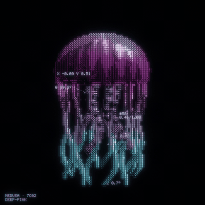
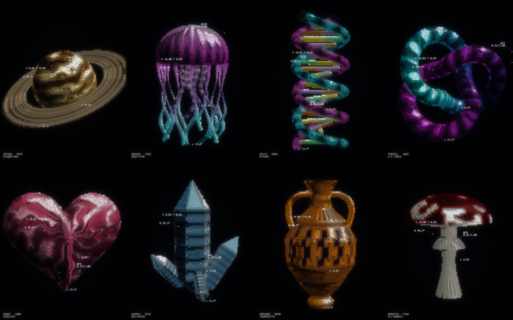
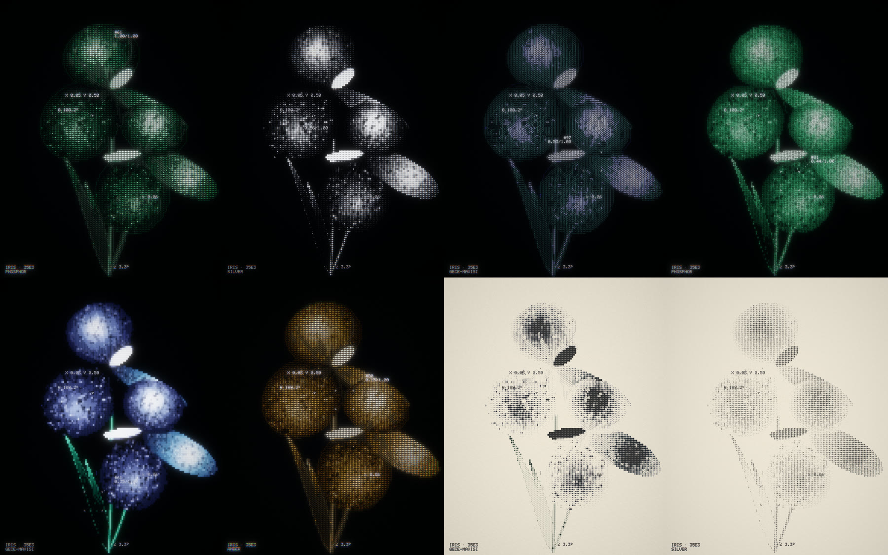
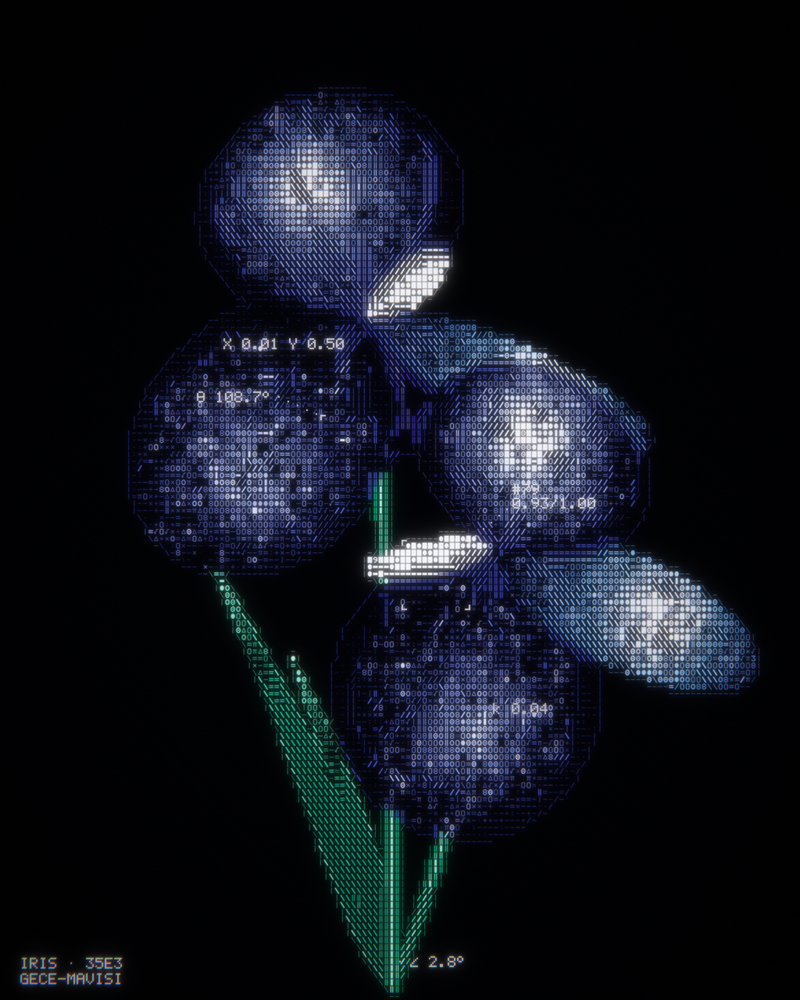

<h1 align="center">Glyph Bloom</h1>

<p align="center">
  Turn any image, GIF or short video into glowing glyph art, then spin it as a 3D object.<br>
  One HTML file. No install, no upload, no server.
</p>

<p align="center">
  <a href="https://winchxyz.github.io/glyph-bloom/"><b>Open the live app →</b></a>
</p>

<p align="center">
  <a href="https://winchxyz.github.io/glyph-bloom/"></a>
</p>

## What it does

Every frame is rebuilt on a fixed 7×9 pixel character grid. Each cell picks its own glyph from what the picture is doing at that spot:

| In the picture | On the grid |
| --- | --- |
| A strong edge | Bold strokes that follow it: `/` `\` `‖` `=` |
| Fine texture with a direction | Thin hatching along that direction |
| Flat areas | A brightness ramp: `.` `-` `=` `√` `π` `0` `◎` `●` `■` |
| The outline of the subject | A thin contour one cell outside it |
| Parts that are still appearing | Flickering digits |

On top of the grid: bloom, a slight colour fringe, film grain, and live readouts (a tracker box, centroid X/Y, the subject's main axis θ, the turn angle ∠).

<p align="center">
  
</p>

## Features



- **Your own files.** Drop, paste or open a PNG, JPG, WebP, GIF or a short MP4/WebM. GIFs and videos stay animated.
- **3D object.** Tick *3D object* and the picture becomes a rounded relief with a front and a back. Drag to turn it, scroll to zoom, or let it turn by itself.
- **Nine templates.** Iris, Planet, Jellyfish, Helix, Knot, Heart, Crystal, Amphora and Mushroom. All are generated in code, so there are no asset files.
- **Grow-in intro.** The subject grows from its lowest point upward, with a ruler counting 0.05 to 0.96 beside the tip.
- **Background removal.** Transparent and single-colour backgrounds are cut automatically and the subject is framed to fit the stage. The panel says what it decided, a *Cut strength* slider tunes it, and *Show what is kept* paints the kept area solid so the cut is visible. Nothing is ever cropped: long pictures and turning 3D objects always stay inside the frame.
- **Nine looks.** Signal, Terminal, Halftone, Blueprint, Matrix, Blocks, Amber CRT, Newsprint and Typewriter. One click sets characters, colour and screen effects.
- **Character sets.** Mixed symbols, classic ASCII, the full 70-character ramp, halftone dots, shade blocks, lines only, digits, binary, or your own characters (sorted from light to heavy automatically).
- **Fine control.** Character size, edge lines, shimmer, outline, colour (from the file or five palettes), vividness, contrast, glow, scanlines, grain, lens fringe, ink on paper. Every control has a one-line explanation.
- **Soundtrack.** A generative score composed from the art: the dominant colour picks the key, brightness the mode, detail the tempo, the file name the melody. Pads, bass, plucks, bells and optional drums run through a reverb and a ping-pong delay. The intro, ruler ticks, trackers and pulses each trigger a sound. Five moods, endless variations, WAV export.
- **Export.** Save a PNG up to 2048 px wide, or record a 12 to 57 second video with the soundtrack (MP4 where the browser can, WebM otherwise).
- **Private.** Files never leave the browser. There is nothing to upload to.

<p align="center">
  
</p>

## Use it

1. Open **https://winchxyz.github.io/glyph-bloom/**
2. Drop a file on the stage, or pick a template.
3. Tune density, glow and colour. Tick *3D object* to turn it.
4. *Save PNG* or *Record video*.

It needs a browser with WebGL 2 (current Chrome, Edge, Firefox and Safari).

## How it works

```
source frame ──► analysis canvas (3×4 samples per cell)
                   │  mask · brightness · structure tensor
                   ▼
              one glyph + colour + level per cell ──► two small data textures
                                                         │
readouts (5×7 pixel font, 2D canvas) ────────────────────┤
                                                         ▼
                              WebGL 2: glyph atlas pass ► 4-level bloom ► composite
```

- **Glyph choice** runs on the CPU, about 20,000 cells per frame. The edge direction comes from a structure tensor over each cell and its neighbours, quantised to four stroke directions.
- **Grow-in order** is a flood fill through the subject from its lowest point, so stems appear before the flowers they carry.
- **3D relief**: thickness comes from the distance to the outline (a circular profile), detail from smoothed brightness. The mesh is lit and drawn by a second small WebGL renderer, and that picture feeds the same glyph grid. The grid stays fixed to the screen while the object turns under it.
- **Templates** are parametric surfaces (lathes, tubes along curves, a faceted crystal) with procedural vertex colours.
- **Soundtrack** is scheduled bar by bar on the Web Audio clock. Hue maps to a key around the circle of fifths, brightness and saturation to one of six modes, edge energy to 60-109 BPM. The arrangement follows the picture: sparse while it grows in, full once it is revealed, thinner when the camera pulls back.
- **GIF decoding** is a built-in LZW decoder, so animated GIFs work in every browser.

## Develop

Everything lives in [`app.html`](app.html): markup, styles and one script. There are no dependencies.

```bash
node build.mjs
```

That wraps `app.html` into the `index.html` GitHub Pages serves. Open `index.html` in a browser to run it locally.

Headless renders for checking changes (needs `playwright-core`):

```bash
node tools/shot.mjs out t=2.5,24
```

```bash
node tools/shot.mjs out tpl=knot t=13 frames=60 step=0.08
```

## Limits

- Busy pictures with small text turn to noise. Clear subjects on plain or dark backgrounds work best.
- A relief is inflated from a flat picture, so its back is a mirror of its front.
- Video is recorded in real time from the canvas. Keep the tab in front while it records.
- The soundtrack is synthesised with Web Audio, so it starts only after you press play.

## License

[MIT](LICENSE)
